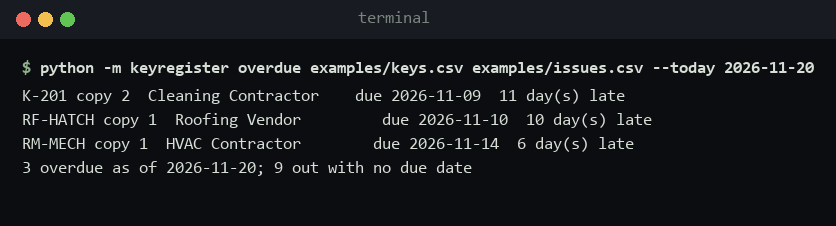

<p align="center"></p>

# key-and-access-register

Keys go missing quietly: a contractor borrows the mechanical room key for a day and it is still in a truck three weeks later. This repo keeps a register of every key and every copy, records who holds which copy, and lists what is past its due date, worst first.



## What it is for

Security and facility administrators who track keys on a clipboard or in a spreadsheet. The register is two plain CSV files, so it can be opened in any spreadsheet. The tool adds the checks a spreadsheet does not do: which copies are free, which are overdue, which holder has what, and whether the log contradicts itself (a copy out to two people, a return before the issue date).

## Install

```
git clone https://github.com/yassine2med/key-and-access-register
cd key-and-access-register && pip install -r requirements.txt
```

No third-party packages are needed. Python 3.10 or newer.

## How to use

| I want to | Command |
|---|---|
| See copies out and free for every key | `PYTHONPATH=src python -m keyregister status examples/keys.csv examples/issues.csv` |
| List overdue keys (worst first) | `PYTHONPATH=src python -m keyregister overdue examples/keys.csv examples/issues.csv --today 2026-11-20` |
| See what a person or company holds | `PYTHONPATH=src python -m keyregister holder examples/issues.csv contractor` |
| Check the log for mistakes | `PYTHONPATH=src python -m keyregister check examples/keys.csv examples/issues.csv` |
| Give out a key (takes the lowest free copy and writes the log) | `PYTHONPATH=src python -m keyregister issue examples/keys.csv my_log.csv K-102 "Tenant Suite 102" --due 2026-12-01` |
| Record a return | `PYTHONPATH=src python -m keyregister return my_log.csv RM-MECH 1` |

Copy `examples/issues.csv` to `my_log.csv` first if you want to try `issue` and `return`, because they write to the log file.

Exit codes: 0 on success, 1 when `overdue` finds late keys or `check` finds problems, 2 on a missing file, bad date or a failed issue or return (for example every copy is out).

Example:

```
PYTHONPATH=src python -m keyregister overdue examples/keys.csv examples/issues.csv --today 2026-11-20
```

Output:

```
K-201 copy 2  Cleaning Contractor    due 2026-11-09  11 day(s) late
RF-HATCH copy 1  Roofing Vendor         due 2026-11-10  10 day(s) late
RM-MECH copy 1  HVAC Contractor        due 2026-11-14  6 day(s) late
3 overdue as of 2026-11-20; 9 out with no due date
```

Status:

```
key       description              copies  out  free
MK-001    Building master               2    2     0
K-101     Suite 101 entry               3    2     1
K-102     Suite 102 entry               2    1     1
K-201     Suite 201 entry               3    2     1
RM-MECH   Mechanical room               2    2     0
RM-ELEC   Electrical room               2    1     1
RF-HATCH  Roof hatch                    1    1     0
GR-GATE   Parking garage gate           4    3     1
```

Issuing and returning on a copy of the log:

```
$ python -m keyregister issue keys.csv my_log.csv K-102 "Tenant Suite 102" --on 2026-11-20 --due 2026-12-01
K-102 copy 2 issued to Tenant Suite 102 on 2026-11-20
$ python -m keyregister return my_log.csv RM-MECH 1 --on 2026-11-20
RM-MECH copy 1 returned by HVAC Contractor on 2026-11-20
$ python -m keyregister issue keys.csv my_log.csv RF-HATCH Someone --on 2026-11-20
Error: all 1 copies of RF-HATCH are out
```

Run the tests with `python -m pytest -q`.

## How it works

1. `keys.csv` lists each key with its number of copies. `issues.csv` has one row per time a copy was handed out: holder, issue date, optional due date, and return date when it came back.
2. A copy is out when its row has no return date. Status counts the open rows per key.
3. Overdue means out, with a due date before the date you give. Keys with no due date (permanent holders) are counted separately.
4. `issue` gives out the lowest free copy number. `return` fills in the return date. Both rewrite the log file.

## Limits

- Dates are plain dates in `YYYY-MM-DD` format. No time of day.
- No reminders or email. Run `overdue` on a schedule and read the result.
- The log file is the only record; it keeps no history of edits made by hand.
- It records who has a key. It does not control any lock.

## License

MIT. Yassine Emhamed, 2026.
